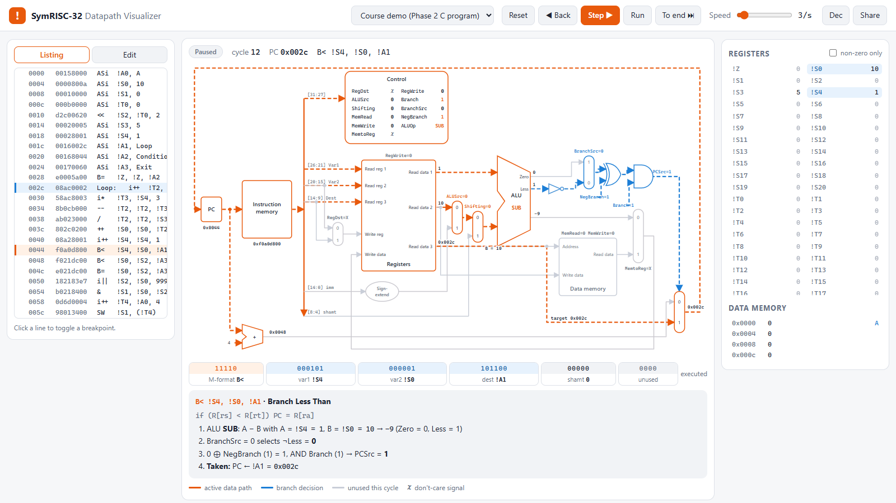

<div align="center">

# SymRISC-32

**A 32-bit RISC instruction set where the mnemonics are the operators,
with a working assembler, disassembler, and signal-level single-cycle CPU simulator.**

[](https://github.com/malfallah/symrisc/actions/workflows/ci.yml)
[](LICENSE)
[](pyproject.toml)
[](pyproject.toml)

**[▶ Open the datapath visualizer](https://malfallah.github.io/symrisc/)**

[ISA specification](docs/isa-spec.md) ·
[Microarchitecture](docs/microarchitecture.md) ·
[Errata](docs/errata.md) ·
[Examples](examples)

</div>

```asm
Loop:   i++  !T2, !S4, 2        // i + 2
        i*   !T3, !S4, 3        // i * 3
        --   !T2, !T2, !T3      // (i + 2) - (i * 3)
        /    !T2, !T2, !S3      // ... / j
        ++   !S0, !S0, !T2      // x += ...
        i++  !S4, !S4, 1        // i++
        B<   !S4, !S0, !A1      // if (i < x) goto Loop
```

SymRISC-32 is a load/store RISC architecture with 25 instructions, two instruction formats, and a 64-entry register file. You write `++` to add, `||` to OR, `<<` to shift, and `B<` to branch if less than; an `i` prefix gives the immediate form, and registers wear a `!` sigil. Underneath the notation it is a conventional RISC design: fixed 32-bit words, a three-read-port register file, and a single-cycle Harvard datapath.

The repository contains the full specification, the datapath and control-unit design, and a dependency-free Python toolchain. The simulator does not just interpret instructions: it evaluates the same multiplexers and control signals as the hardware diagram, cycle by cycle.

<p align="center">
  <a href="https://malfallah.github.io/symrisc/"></a>
</p>

## Highlights

- **Interactive datapath visualizer.** [Run programs in your browser](https://malfallah.github.io/symrisc/) and watch every wire, multiplexer and control signal light up, cycle by cycle. You can step backwards, set breakpoints, read a plain-language explanation of each cycle, and share a program as a link.
- **Executable specification.** One table in [`symrisc/isa.py`](symrisc/isa.py) drives the assembler, the disassembler, the control unit, and the documentation.
- **Signal-level simulation.** Every cycle drives `RegDst`, `ALUSrc`, `Shifting`, `MemtoReg`, `BranchSrc`, `NegBranch` and `ALUOp` through the real datapath. `--trace --signals` shows each instruction's control word.
- **Verified design.** Branches are checked against every pair of 8 boundary values, including `INT_MIN`/`INT_MAX`. A C reference program is checked against its hand-compiled assembly, and each example runs twice to show that don't-care (`X`) control signals never affect the result.
- **Fixed, not just transcribed.** Seven hardware defects in the original design, including an ALUOp encoding collision, a `B>` that behaved as `≥`, and overflow-blind comparisons, were found and corrected. Each fix has a regression test. See the [errata](docs/errata.md).
- **Hardware-friendly output.** Assemble to a listing, raw hex (`$readmemh`), binary, or a Logisim `v2.0 raw` ROM image.
- **Zero dependencies.** Python 3.10+ and the standard library. Clone and run.

## Quick start

```bash
git clone https://github.com/malfallah/symrisc.git
cd symrisc

python -m symrisc run examples/course_demo.s --trace     # run with a cycle trace
python -m unittest discover -s tests -t .               # run the test suite
```

Optionally, install the `symrisc` command:

```bash
pip install -e .
symrisc --help
```

<details>
<summary><b>Sample trace output</b></summary>

```text
$ symrisc run examples/course_demo.s --trace
cycle  pc      word      instruction               effect
    1  0x0000  00158000  ASi  !A0, 0               !A0 = 0
    2  0x0004  0000800a  ASi  !S0, 10              !S0 = 10
  ...
   11  0x0028  e0005a00  B=   !Z, !Z, !A2          PC -> 0x0044
   12  0x0044  f0a0d800  B<   !S4, !S0, !A1        PC -> 0x002c
   13  0x002c  08ac0002  i++  !T2, !S4, 2          !T2 = 3
   14  0x0030  58ac8003  i*   !T3, !S4, 3          !T3 = 3
   15  0x0034  8b0cb000  --   !T2, !T2, !T3        !T2 = 0
   16  0x0038  ab023000  /    !T2, !T2, !S3        !T2 = 0
   17  0x003c  802c0200  ++   !S0, !S0, !T2        !S0 = 10
  ...

halted after 60 cycles, PC = 0x0060

registers:
  !S0   0x00000006             6
  !S1   0x00000006             6
  !S2   0x000003e7           999
  ...

data memory:
  0x0000  0x00000000             0  A
  0x0004  0x00000006             6
```

</details>

## The ISA at a glance

### Instruction formats

The most significant opcode bit selects the format: `0` → **B** (immediate), `1` → **M** (register).

```
B-format   31     27 26      21 20      15 14                          0
          ┌─────────┬──────────┬──────────┬─────────────────────────────┐
          │ opcode  │   Var1   │   Var2   │      Constant / Address     │
          │    5    │    6     │    6     │             15              │
          └─────────┴──────────┴──────────┴─────────────────────────────┘

M-format   31     27 26      21 20      15 14       9 8       4 3      0
          ┌─────────┬──────────┬──────────┬──────────┬─────────┬────────┐
          │ opcode  │   Var1   │   Var2   │   Dest   │  Shamt  │ unused │
          │    5    │    6     │    6     │    6     │    5    │   4    │
          └─────────┴──────────┴──────────┴──────────┴─────────┴────────┘
```

### Instructions

| Class | Instructions |
|---|---|
| Arithmetic | `++` add · `--` subtract · `*` multiply · `/` divide |
| Logic | `&` and · `\|\|` or · `~` not · `SLT` set-less-than |
| Shift | `<<` logical left · `>>` logical right |
| Immediate | `ASi` assign · `i++` · `i--` · `i*` · `i/` · `i&` · `i\|\|` · `i~` · `LA` load address |
| Memory | `LW` load word · `SW` store word |
| Branch | `B=` · `B!=` · `B<` · `B>` (register-indirect: `PC ← R[ra]`) |

<details>
<summary><b>Opcode map</b></summary>

| `[4:3]` \ `[2:0]` | `000` | `001` | `010` | `011` | `100` | `101` | `110` | `111` |
|---|---|---|---|---|---|---|---|---|
| **`00`** (B) | `ASi` | `i++` | `i&` | `i\|\|` | `i~` | `i/` | — | — |
| **`01`** (B) | — | — | — | `i*` | `i--` | `LA` | — | — |
| **`10`** (M) | `++` | `--` | `LW` | `SW` | `*` | `/` | `&` | `\|\|` |
| **`11`** (M) | `~` | `SLT` | `<<` | `>>` | `B=` | `B!=` | `B<` | `B>` |

</details>

### Registers

| Register | Number | Role |
|---|---|---|
| `!Z` | 0 | Hard-wired zero |
| `!S0` – `!S20` | 1 – 21 | Saved |
| `!T0` – `!T20` | 22 – 42 | Temporary |
| `!A0` – `!A16` | 43 – 59 | Address / branch target |
| `!GP` `!SP` `!FP` `!RA` | 60 – 63 | Global, stack, frame pointer; return address |

The full semantics, encoding rules and assembler syntax are in the **[ISA specification](docs/isa-spec.md)**.

## Microarchitecture

<p align="center">
  
</p>

The single-cycle datapath reads three registers at once. `Var1` and `Var2` feed the ALU, and `Dest` supplies the memory address for loads and stores or the target for branches, so no instruction needs the ALU to compute an address. A compact branch unit derives every condition from the ALU's `Zero` and `Less` flags:

```
PCSrc = Branch · ((BranchSrc ? Zero : ¬Less) ⊕ NegBranch)
```

The **[microarchitecture document](docs/microarchitecture.md)** has the wiring, the full control-unit truth table, the ALU encoding, and per-instruction walkthroughs.

## Datapath visualizer

The [visualizer](https://malfallah.github.io/symrisc/) is a static web app in [`web/`](web), with no build step and no dependencies. You can also open `web/index.html` directly from disk.

- **Watch the hardware work.** Paths the current instruction uses are animated, and unused paths fade out. The highlighting is derived from the control signals alone, so it always matches what the control unit selects.
- **Every value on every wire.** Read data 1/2/3, the sign-extended immediate, ALU operand B, the ALU result, the `Zero`/`Less` flags, write-back data, PC + 4, and the branch target.
- **Explains itself.** Each cycle comes with a step-by-step explanation, e.g. *"BranchSrc = 0 selects ¬Less = 0; 0 ⊕ NegBranch (1) = 1, AND Branch (1) → PCSrc = 1"*.
- **Debugger controls.** Step, step back, run at an adjustable speed, run to the end, and click-to-toggle breakpoints. Keys: `→` `←` `Space` `R`.
- **Write your own.** Edit and assemble programs in the browser (with `file:line` error messages), then share them as a link.
- **Light and dark themes**, with a layout that adapts down to phone width.

The browser runs a JavaScript port of the reference model. A conformance test runs both implementations on the examples, error cases, and 300 random programs, and requires them to agree on every cycle.

## Toolchain

```text
symrisc asm  <file.s>  [-f listing|hex|bin|logisim] [-o out]   assemble
symrisc dis  <file.hex>                                         disassemble
symrisc run  <file.s|file.hex> [--trace] [--signals]            simulate
             [--mem ADDR:COUNT] [--max-cycles N] [--dont-care 0|1]
```

```text
$ symrisc asm examples/fibonacci.s
addr  word      fields                                  source
0000  00158000  00000 000000 101011 000000000000000     ASi  !A0, fib           // p = &fib[0]
0004  000b000c  00000 000000 010110 000000000001100     ASi  !T0, 12            // n = N
...
```

Use it as a library, too:

```python
from symrisc import CPU, assemble

cpu = CPU(assemble(open("examples/bubble_sort.s").read())).run_to_completion()
print(cpu.cycles, cpu.memory.words(0, 8, signed=True))  # 284 [-300, -7, 0, 7, 7, 19, 42, 1000]
```

## Examples

| Program | What it shows |
|---|---|
| [`course_demo.s`](examples/course_demo.s) | The original Phase 2 C program ([`course_demo.c`](examples/course_demo.c)), compiled by hand: loops, signed division, conditionals, stores |
| [`fibonacci.s`](examples/fibonacci.s) | Pointer walking, register moves, `B>` loop control |
| [`bubble_sort.s`](examples/bubble_sort.s) | Nested loops, `LW`/`SW`, in-place swaps on signed data |

## Verification

The suite (`python -m unittest discover -s tests -t .`) checks:

- **Encodings.** Golden machine words worked out by hand from the field layout, plus assemble → disassemble → assemble round-trips for all 25 instructions.
- **ISA invariants.** The formats tile all 32 bits, the opcode MSB matches the format, opcodes are unique, every opcode has a control row, and distinct operations get distinct ALU codes.
- **Branch logic.** All four branches over every pair of 8 boundary values (64 pairs each), under both don't-care resolutions.
- **Semantics.** Truncating signed division, division by zero, `INT_MIN / −1`, logical vs. arithmetic shift, writes to `!Z`, and alignment faults.
- **Programs.** The demo program against a Python transliteration of its C source, Fibonacci, and bubble sort.
- **Don't-care safety.** Each example runs with `X = 0` and `X = 1` and must produce identical results.
- **Browser parity.** The JavaScript model behind the visualizer must match the Python model cycle for cycle on the examples, the assembler error cases, faults, and 300 random programs. This needs Node.js and is skipped without it.

CI runs the suite on Linux, Windows, and macOS across Python 3.10–3.14.

## Project layout

```text
symrisc/
├── symrisc/                 Python package
│   ├── isa.py               formats, fields, registers, opcodes (single source of truth)
│   ├── assembler.py         two-pass assembler and disassembler
│   ├── control.py           control-unit truth table and ALU
│   ├── cpu.py               signal-level single-cycle datapath model
│   └── cli.py               `symrisc asm | dis | run`
├── web/                     datapath visualizer (static site, deployed to GitHub Pages)
├── examples/                assembly programs (+ the C source of the demo)
├── scripts/                 build helpers (bundles examples for the visualizer)
├── tests/                   unittest suite (+ JS conformance harness)
└── docs/
    ├── isa-spec.md          normative ISA specification
    ├── microarchitecture.md datapath, control, ALU, branch unit
    ├── errata.md            defects found in the original design and their fixes
    ├── images/              datapath figure, visualizer screenshot
    └── reports/             original Phase 1 / Phase 2 coursework reports (PDF)
```

## Roadmap

- [ ] Synthesizable Verilog implementation of the single-cycle core, with a testbench driven by `symrisc asm -f hex`
- [ ] A five-stage pipelined variant with forwarding and hazard detection
- [ ] A jump-and-link instruction and a documented calling convention using `!RA`/`!SP`/`!FP`
- [ ] A Logisim Evolution circuit of the datapath
- [x] A browser-based datapath visualizer

Contributions toward any of these are welcome. See [CONTRIBUTING.md](CONTRIBUTING.md).

## Background

SymRISC-32 was designed in spring 2022 as the term project for *CSC320 Computer Organization*, taught by Dr. Sanaa Sharafeddine Dawy, by **Mohammad Al Fallah**, **Hussien Ali-Ahmad**, **Bilal Delbani**, and **Mohammad Alizzi**. Phase 1 defined the instruction set and Phase 2 designed the single-cycle datapath and control. Version 1.0 turns those reports into an executable, tested specification. The original reports are preserved in [`docs/reports`](docs/reports), and every deviation from them is documented in the [errata](docs/errata.md).

## Citation

If you use SymRISC-32 in teaching or research, please cite it. GitHub's **"Cite this repository"** button reads [`CITATION.cff`](CITATION.cff).

## License

Released under the [Apache License 2.0](LICENSE). See [NOTICE](NOTICE) for attribution.
