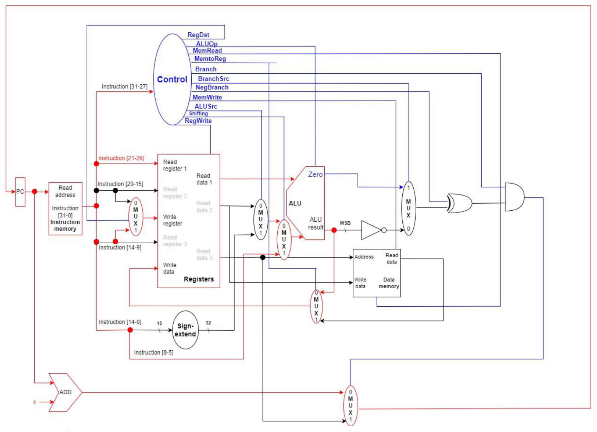
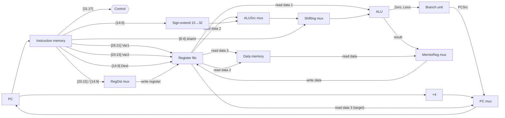
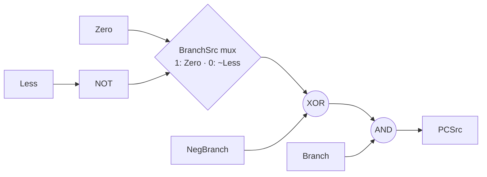

# SymRISC-32 Single-Cycle Microarchitecture

This document describes the single-cycle datapath and the control unit that implement the [SymRISC-32 ISA](isa-spec.md). The signal-level model in [`symrisc/cpu.py`](../symrisc/cpu.py) and [`symrisc/control.py`](../symrisc/control.py) mirrors it wire for wire. Run any program with `symrisc run --trace --signals` to watch the control signals cycle by cycle, or open the [interactive visualizer](https://malfallah.github.io/symrisc/) to see the datapath animate.

## Contents

1. [Overview](#1-overview)
2. [Datapath](#2-datapath)
3. [Main control unit](#3-main-control-unit)
4. [ALU and ALU control](#4-alu-and-alu-control)
5. [Branch unit](#5-branch-unit)
6. [Instruction walkthroughs](#6-instruction-walkthroughs)

---

## 1. Overview

* **Single cycle.** Each instruction is fetched, decoded, executed, and retired in one clock cycle, so CPI = 1. The clock period is set by the slowest path, `LW`: instruction memory → register file → data memory → write-back.
* **Harvard.** Instruction memory and data memory are separate, so an instruction fetch and a data access can happen in the same cycle.
* **Three read ports.** The register file reads `Var1`, `Var2` and `Dest` at the same time. The third port (`Read data 3`) provides the memory address for `LW`/`SW` and the target address for branches. Because of it, branches and memory accesses need no address arithmetic in the ALU.

## 2. Datapath

*Original Phase 2 figure. Version 1.0 applies four corrections to it: a 4-bit `ALUOp`, an overflow-corrected `Less` flag in place of the raw result MSB, the shift amount widened to `Instruction[8:4]`, and `B>` executed as a reverse subtract. See [errata.md](errata.md).*

### Wiring

| Signal / port | Source |
|---|---|
| Control input | `Instruction[31:27]` (opcode) |
| Read register 1 | `Instruction[26:21]` (Var1) |
| Read register 2 | `Instruction[20:15]` (Var2) |
| Read register 3 | `Instruction[14:9]` (Dest) |
| Write register | `RegDst` ? `Instruction[14:9]` : `Instruction[20:15]` |
| ALU operand A | Read data 1 |
| ALU operand B | `Shifting` ? `zext(Instruction[8:4])` : (`ALUSrc` ? `sext(Instruction[14:0])` : Read data 2) |
| Data memory address | Read data 3 |
| Data memory write data | Read data 2 |
| Register write data | `MemtoReg` ? memory read data : ALU result |
| Next PC | `PCSrc` ? Read data 3 : PC + 4 |

## 3. Main control unit

The control unit is a pure function of the 5-bit opcode. `X` marks a don't-care. The simulator can drive every X as 0 or as 1 (`--dont-care 0|1`), and the test suite checks that every example program produces identical results either way. The signals that change architectural state (`MemRead`, `MemWrite`, `RegWrite`, `Branch`) are never don't-care.

| Instruction | RegDst | ALUSrc | Shifting | MemRead | MemWrite | MemtoReg | RegWrite | Branch | BranchSrc | NegBranch | ALUOp |
|---|---|---|---|---|---|---|---|---|---|---|---|
| `ASi` | 0 | 1 | 0 | 0 | 0 | 0 | 1 | 0 | X | X | `0000` ADD |
| `i++` | 0 | 1 | 0 | 0 | 0 | 0 | 1 | 0 | X | X | `0000` ADD |
| `i&` | 0 | 1 | 0 | 0 | 0 | 0 | 1 | 0 | X | X | `0010` AND |
| `i\|\|` | 0 | 1 | 0 | 0 | 0 | 0 | 1 | 0 | X | X | `0011` OR |
| `i~` | 0 | 1 | 0 | 0 | 0 | 0 | 1 | 0 | X | X | `1000` NOT |
| `i/` | 0 | 1 | 0 | 0 | 0 | 0 | 1 | 0 | X | X | `0100` DIV |
| `i*` | 0 | 1 | 0 | 0 | 0 | 0 | 1 | 0 | X | X | `0101` MUL |
| `i--` | 0 | 1 | 0 | 0 | 0 | 0 | 1 | 0 | X | X | `0001` SUB |
| `LA` | 0 | 1 | 0 | 0 | 0 | 0 | 1 | 0 | X | X | `0000` ADD |
| `++` | 1 | 0 | 0 | 0 | 0 | 0 | 1 | 0 | X | X | `0000` ADD |
| `--` | 1 | 0 | 0 | 0 | 0 | 0 | 1 | 0 | X | X | `0001` SUB |
| `LW` | 0 | X | X | 1 | 0 | 1 | 1 | 0 | X | X | X |
| `SW` | X | X | X | 0 | 1 | X | 0 | 0 | X | X | X |
| `*` | 1 | 0 | 0 | 0 | 0 | 0 | 1 | 0 | X | X | `0101` MUL |
| `/` | 1 | 0 | 0 | 0 | 0 | 0 | 1 | 0 | X | X | `0100` DIV |
| `&` | 1 | 0 | 0 | 0 | 0 | 0 | 1 | 0 | X | X | `0010` AND |
| `\|\|` | 1 | 0 | 0 | 0 | 0 | 0 | 1 | 0 | X | X | `0011` OR |
| `~` | 1 | 0 | 0 | 0 | 0 | 0 | 1 | 0 | X | X | `1000` NOT |
| `SLT` | 1 | 0 | 0 | 0 | 0 | 0 | 1 | 0 | X | X | `1001` SLT |
| `<<` | 1 | X | 1 | 0 | 0 | 0 | 1 | 0 | X | X | `0110` SLL |
| `>>` | 1 | X | 1 | 0 | 0 | 0 | 1 | 0 | X | X | `0111` SRL |
| `B=` | X | 0 | 0 | 0 | 0 | X | 0 | 1 | 1 | 0 | `0001` SUB |
| `B!=` | X | 0 | 0 | 0 | 0 | X | 0 | 1 | 1 | 1 | `0001` SUB |
| `B<` | X | 0 | 0 | 0 | 0 | X | 0 | 1 | 0 | 1 | `0001` SUB |
| `B>` | X | 0 | 0 | 0 | 0 | X | 0 | 1 | 0 | 1 | `1010` RSUB |

### Signal reference

| Signal | 0 | 1 |
|---|---|---|
| `RegDst` | write `Var2` [20:15] (B-format, `LW`) | write `Dest` [14:9] (M-format ALU ops) |
| `ALUSrc` | ALU B ← Read data 2 | ALU B ← sign-extended constant |
| `Shifting` | ALU B ← `ALUSrc` mux | ALU B ← `shamt` [8:4] |
| `MemRead` | — | read data memory at Read data 3 |
| `MemWrite` | — | write Read data 2 to data memory at Read data 3 |
| `MemtoReg` | write back ALU result | write back memory read data |
| `RegWrite` | — | write the register file |
| `Branch` | — | the instruction is a conditional branch |
| `BranchSrc` | condition ← `~Less` | condition ← `Zero` |
| `NegBranch` | take branch when condition = 1 | take branch when condition = 0 |
| `ALUOp` | 4-bit operation code, see below | |

## 4. ALU and ALU control

The main control unit drives `ALUOp` directly. Codes `0000`–`0111` keep their values from the original 3-bit design. The original field could not encode NOT separately from AND (both were `010`), so it was widened to 4 bits.

| ALUOp | Operation | Result | Used by |
|---|---|---|---|
| `0000` | ADD | A + B | `ASi`, `i++`, `LA`, `++` |
| `0001` | SUB | A − B | `i--`, `--`, `B=`, `B!=`, `B<` |
| `0010` | AND | A & B | `i&`, `&` |
| `0011` | OR | A \| B | `i\|\|`, `\|\|` |
| `0100` | DIV | A / B (signed, truncating) | `i/`, `/` |
| `0101` | MUL | A × B (low 32 bits) | `i*`, `*` |
| `0110` | SLL | A << B[4:0] | `<<` |
| `0111` | SRL | A >>> B[4:0] | `>>` |
| `1000` | NOT | ~B | `i~`, `~` |
| `1001` | SLT | (A < B) ? 1 : 0 (signed) | `SLT` |
| `1010` | RSUB | B − A | `B>` |
| `1011`–`1111` | — | reserved | |

**Status outputs.**

* `Zero` = (result == 0)
* `Less` = the sign of the *exact* difference for SUB/RSUB, i.e. `N ⊕ V` (negative flag XOR signed overflow). For every other operation it is the result MSB.

The original design tapped the raw MSB of the ALU result. That gives the wrong answer whenever the subtraction overflows. For example, `INT_MAX − (−1)` wraps to a negative number, so `INT_MAX < −1` would be reported as true.

## 5. Branch unit

`PCSrc = Branch · (cond ⊕ NegBranch)`, where `cond = BranchSrc ? Zero : ~Less`.

| Instr. | ALU computes | BranchSrc | cond | NegBranch | Taken when |
|---|---|---|---|---|---|
| `B=` | rs − rt | 1 | `Zero` | 0 | rs − rt = 0 ⇔ **rs = rt** |
| `B!=` | rs − rt | 1 | `Zero` | 1 | rs − rt ≠ 0 ⇔ **rs ≠ rt** |
| `B<` | rs − rt | 0 | `~Less` | 1 | rs − rt < 0 ⇔ **rs < rt** |
| `B>` | rt − rs | 0 | `~Less` | 1 | rt − rs < 0 ⇔ **rs > rt** |

`B>` uses the reverse subtract so that it reuses the `B<` logic with the operands swapped. The original design computed `rs − rt` and branched on `~MSB`, which is also true when `rs = rt`. That made `B>` behave as `≥`.

## 6. Instruction walkthroughs

**`++ !T1, !S0, !S1`** (M-format ALU). Read register 1 = `!S0` and read register 2 = `!S1`. `ALUSrc = 0`, so the ALU adds Read data 1 and Read data 2. `RegDst = 1` selects `Dest` = `!T1` as the write register, and `MemtoReg = 0` writes back the ALU result.

**`i++ !T2, !S4, 2`** (B-format ALU). Read register 1 = `!S4`. `ALUSrc = 1` routes the sign-extended constant 2 to ALU operand B. `RegDst = 0` writes the sum to `Var2` = `!T2`.

**`<< !S2, !T0, 2`** (shift). `Shifting = 1` replaces ALU operand B with `shamt = 2`. The ALU performs SLL on Read data 1 (`!T0`), and the result is written to `Dest` = `!S2`.

**`LW !S2, (!A1)`** (load). Read register 3 = `!A1`, and Read data 3 addresses data memory. `MemRead = 1` and `MemtoReg = 1` route the loaded word to the write port, with `RegDst = 0` selecting `Var2` = `!S2`. The ALU result is ignored.

**`SW !S1, (!T4)`** (store). Read data 3 (`!T4`) is the address and Read data 2 (`!S1`) is the value. `MemWrite = 1` and `RegWrite = 0`.

**`B< !S4, !S0, !A1`** (branch). The ALU computes `!S4 − !S0`. With `BranchSrc = 0`, the mux selects `~Less`, and `NegBranch = 1` inverts it, so the condition is `Less`. If `Branch` is set and the condition holds, `PCSrc = 1` and the PC loads Read data 3 (`!A1`). Otherwise it loads PC + 4. `RegWrite = 0` and `MemWrite = 0`, so no state other than the PC changes.
